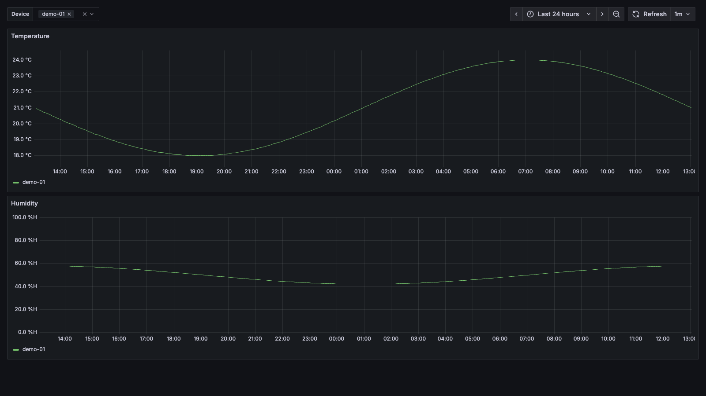
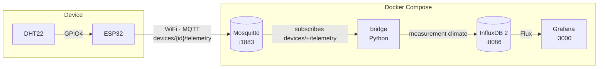

# esp32-iot-kit

Ready-to-use IoT template: an ESP32 with a DHT22 publishes temperature and humidity over MQTT, and you see them in Grafana within minutes.

[Leer en español](docs/README.es.md)

[](LICENSE)
[](https://github.com/joaquincuevas/esp32-iot-kit/actions/workflows/ci.yml)
[](https://github.com/joaquincuevas/esp32-iot-kit/releases)



## Quick start

Requires an ESP32 DevKit with a DHT22 sensor ([wiring](#required-hardware)), Docker with Compose v2.20+ and [PlatformIO](https://platformio.org/install/cli).

1. Clone the repository:
   ```bash
   git clone https://github.com/joaquincuevas/esp32-iot-kit.git && cd esp32-iot-kit
   ```
2. Create `.env` and replace **every** `change-me-*` value (for example with `openssl rand -hex 24`):
   ```bash
   cp .env.example .env
   ```
3. Start Mosquitto, InfluxDB, Grafana and the bridge:
   ```bash
   docker compose up -d
   ```
4. Create the firmware config and fill in WiFi, `MQTT_HOST` (your machine's IP on the local network) and the MQTT credentials from `.env`:
   ```bash
   cp firmware/include/config.example.h firmware/include/config.h
   ```
5. Connect the ESP32 over USB, flash the firmware and watch the serial log:
   ```bash
   cd firmware && pio run -t upload && pio device monitor
   ```

Open <http://localhost:3000/d/esp32-climate> (user and password: `GRAFANA_ADMIN_USER`/`GRAFANA_ADMIN_PASSWORD`). The first reading arrives as soon as the device connects.

## Architecture



The ESP32 reads the sensor every 60 s and publishes to `devices/{device_id}/telemetry`:

```json
{"temperature": 23.40, "humidity": 45.10, "ts": 1762171200}
```

The bridge validates each message and writes it to InfluxDB (measurement `climate`, tag `device_id`, fields `temperature` and `humidity`). Grafana starts with the datasource and dashboard already provisioned.

## Required hardware

| Component | Quantity |
|---|---|
| ESP32 DevKit (ESP32-WROOM-32) | 1 |
| DHT22 (AM2302) sensor, preferably on a 3-pin module | 1 |
| 10 kΩ resistor (only if the DHT22 is not on a module) | 1 |
| USB data cable and 3 dupont wires | — |

| DHT22 | ESP32 |
|---|---|
| VCC (`+`) | `3V3` |
| DATA (`out`) | `GPIO4` |
| GND (`-`) | `GND` |

Bare-sensor wiring diagram, power and calibration: [docs/hardware.md](docs/hardware.md) (Spanish).

**Software:** Docker with Compose v2.20 or later and [PlatformIO](https://platformio.org/install/cli) (CLI or VS Code extension). The firmware pins the `espressif32@6.9.0` platform (Arduino-ESP32 core 2.0.17, ESP-IDF 4.4.7) in [platformio.ini](firmware/platformio.ini).

## Configuration

### Server (`.env`)

| Variable | Description | Example |
|---|---|---|
| `MQTT_USER` | MQTT user for the ESP32 and the bridge | `esp32` |
| `MQTT_PASSWORD` | MQTT password | — |
| `INFLUX_ADMIN_USER` | InfluxDB UI admin user | `admin` |
| `INFLUX_ADMIN_PASSWORD` | InfluxDB admin password (min. 8 characters) | — |
| `INFLUX_ORG` | InfluxDB organization | `esp32-iot-kit` |
| `INFLUX_BUCKET` | Bucket where readings are stored | `telemetry` |
| `INFLUX_TOKEN` | Admin token, used by the bridge and Grafana | — |
| `GRAFANA_ADMIN_USER` | Grafana admin user | `admin` |
| `GRAFANA_ADMIN_PASSWORD` | Grafana admin password | — |

The `INFLUX_*` variables are applied only on first start (see [troubleshooting](docs/troubleshooting.md#influxdb-rechaza-el-token-después-de-editar-env)). The bridge can also run outside Docker, reading `MQTT_HOST`, `MQTT_PORT` (default `1883`) and `INFLUX_URL` from the environment.

### Firmware (`firmware/include/config.h`)

| Constant | Description | Default |
|---|---|---|
| `WIFI_SSID` / `WIFI_PASSWORD` | **2.4 GHz** WiFi network | — |
| `MQTT_HOST` | Local IP of the machine running Docker | `192.168.1.100` |
| `MQTT_PORT` | Mosquitto port | `1883` |
| `MQTT_USER` / `MQTT_PASSWORD` | Same values as in `.env` | — |
| `DEVICE_ID` | Unique identifier; used in the topic and the InfluxDB tag | `esp32-01` |
| `DHT_PIN` | DHT22 data GPIO | `4` |
| `READ_INTERVAL_MS` | Interval between readings | `60000` |
| `TEMP_OFFSET_C` / `HUMIDITY_OFFSET` | Calibration added to every reading | `0.0` |
| `NTP_SERVER` | Time server for the `ts` field | `pool.ntp.org` |

`config.h` is in `.gitignore`. Without it, `pio run` builds with the example values and prints a warning.

## Ports

| Service | Port | Reachable from |
|---|---|---|
| Mosquitto | `1883` | Local network (used by the ESP32 devices) |
| Grafana | `3000` | Local network |
| InfluxDB | `8086` | `localhost` only |

## Limitations

- **v0.1 does not store readings while the MQTT connection is down.** If WiFi or the broker goes down, those readings are lost.
- MQTT runs without TLS: meant for a trusted local network, not for exposing port 1883 to the internet.
- All devices and the bridge share a single MQTT user, with no per-device ACL.
- Only the DHT22 sensor and 2.4 GHz WiFi networks are supported.
- If the ESP32 cannot sync NTP, the bridge uses the receive time as the timestamp.

## Troubleshooting

The most common issues (serial port, 5 GHz WiFi, MQTT credentials, NTP not synced, no data in Grafana) are covered in [docs/troubleshooting.md](docs/troubleshooting.md) (Spanish).

## Roadmap

- **v0.2:** captive portal provisioning for WiFi and MQTT (no recompiling) and deep sleep for battery operation.
- **v0.3:** signed OTA updates.

## Contributing

Issues and PRs are welcome. Read [CONTRIBUTING.md](CONTRIBUTING.md) to set up the environment and run the tests.

## License

[MIT](LICENSE) © 2026 Joaquin
