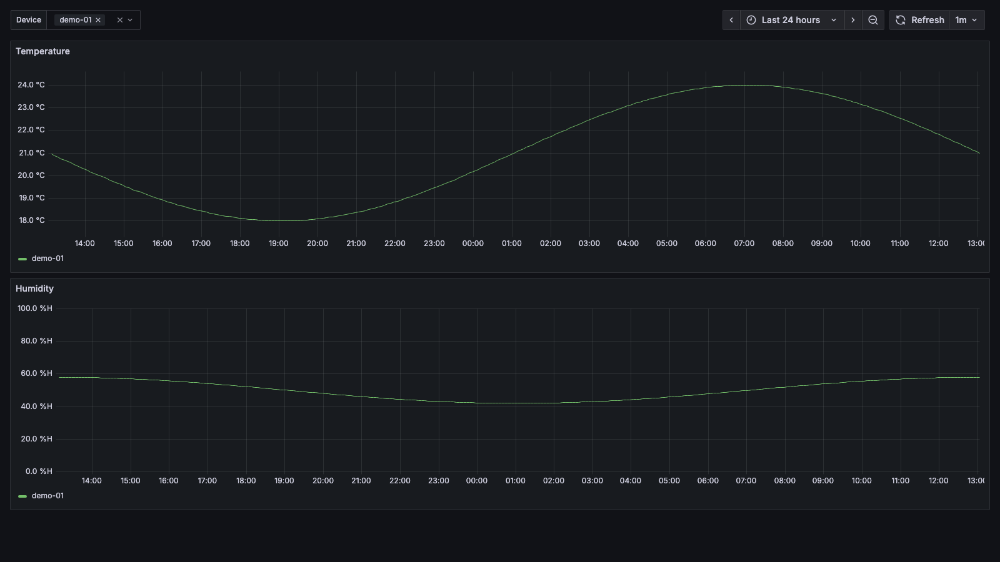
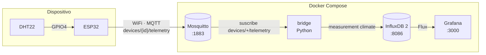

# esp32-iot-kit

Plantilla IoT lista para usar: un ESP32 con DHT22 publica temperatura y humedad por MQTT y las ves en Grafana en minutos.

[Read in English](../README.md)

[](../LICENSE)
[](https://github.com/joaquincuevas/esp32-iot-kit/actions/workflows/ci.yml)
[](https://github.com/joaquincuevas/esp32-iot-kit/releases)



## Inicio rápido

Necesitas un ESP32 DevKit con un sensor DHT22 ([cableado](#hardware-requerido)), Docker con Compose v2.20+ y [PlatformIO](https://platformio.org/install/cli).

1. Clona el repositorio:
   ```bash
   git clone https://github.com/joaquincuevas/esp32-iot-kit.git && cd esp32-iot-kit
   ```
2. Crea `.env` y cambia **todos** los valores `change-me-*` (por ejemplo con `openssl rand -hex 24`):
   ```bash
   cp .env.example .env
   ```
3. Levanta Mosquitto, InfluxDB, Grafana y el bridge:
   ```bash
   docker compose up -d
   ```
4. Crea la configuración del firmware y completa WiFi, `MQTT_HOST` (la IP de tu equipo en la red local) y las credenciales MQTT de `.env`:
   ```bash
   cp firmware/include/config.example.h firmware/include/config.h
   ```
5. Conecta el ESP32 por USB, súbele el firmware y mira el log serie:
   ```bash
   cd firmware && pio run -t upload && pio device monitor
   ```

Abre <http://localhost:3000/d/esp32-climate> (usuario y contraseña: `GRAFANA_ADMIN_USER`/`GRAFANA_ADMIN_PASSWORD`). La primera lectura llega al conectar.

## Arquitectura



El ESP32 lee el sensor cada 60 s y publica en `devices/{device_id}/telemetry`:

```json
{"temperature": 23.40, "humidity": 45.10, "ts": 1762171200}
```

El bridge valida cada mensaje y lo escribe en InfluxDB (measurement `climate`, tag `device_id`, fields `temperature` y `humidity`). Grafana arranca con el datasource y el dashboard ya configurados.

## Hardware requerido

| Componente | Cantidad |
|---|---|
| ESP32 DevKit (ESP32-WROOM-32) | 1 |
| Sensor DHT22 (AM2302), idealmente en módulo de 3 pines | 1 |
| Resistencia 10 kΩ (solo si el DHT22 no viene en módulo) | 1 |
| Cable USB de datos y 3 cables dupont | — |

| DHT22 | ESP32 |
|---|---|
| VCC (`+`) | `3V3` |
| DATA (`out`) | `GPIO4` |
| GND (`-`) | `GND` |

Diagrama del sensor suelto, alimentación y calibración en [docs/hardware.md](hardware.md).

**Software:** Docker con Compose v2.20 o superior y [PlatformIO](https://platformio.org/install/cli) (CLI o extensión de VS Code). El firmware fija la plataforma `espressif32@6.9.0` (core Arduino-ESP32 2.0.17, ESP-IDF 4.4.7) en [platformio.ini](../firmware/platformio.ini).

## Configuración

### Servidor (`.env`)

| Variable | Descripción | Ejemplo |
|---|---|---|
| `MQTT_USER` | Usuario MQTT para el ESP32 y el bridge | `esp32` |
| `MQTT_PASSWORD` | Contraseña MQTT | — |
| `INFLUX_ADMIN_USER` | Usuario admin de la UI de InfluxDB | `admin` |
| `INFLUX_ADMIN_PASSWORD` | Contraseña admin de InfluxDB (mín. 8 caracteres) | — |
| `INFLUX_ORG` | Organización de InfluxDB | `esp32-iot-kit` |
| `INFLUX_BUCKET` | Bucket donde se guardan las lecturas | `telemetry` |
| `INFLUX_TOKEN` | Token admin, usado por el bridge y Grafana | — |
| `GRAFANA_ADMIN_USER` | Usuario admin de Grafana | `admin` |
| `GRAFANA_ADMIN_PASSWORD` | Contraseña admin de Grafana | — |

Las variables `INFLUX_*` solo se aplican en el primer arranque (ver [troubleshooting](troubleshooting.md#influxdb-rechaza-el-token-después-de-editar-env)). El bridge también puede correr fuera de Docker leyendo `MQTT_HOST`, `MQTT_PORT` (por defecto `1883`) e `INFLUX_URL` del entorno.

### Firmware (`firmware/include/config.h`)

| Constante | Descripción | Por defecto |
|---|---|---|
| `WIFI_SSID` / `WIFI_PASSWORD` | Red WiFi de **2,4 GHz** | — |
| `MQTT_HOST` | IP local del equipo con Docker | `192.168.1.100` |
| `MQTT_PORT` | Puerto de Mosquitto | `1883` |
| `MQTT_USER` / `MQTT_PASSWORD` | Mismos valores que en `.env` | — |
| `DEVICE_ID` | Identificador único; va en el topic y en el tag de InfluxDB | `esp32-01` |
| `DHT_PIN` | GPIO de datos del DHT22 | `4` |
| `READ_INTERVAL_MS` | Intervalo entre lecturas | `60000` |
| `TEMP_OFFSET_C` / `HUMIDITY_OFFSET` | Calibración que se suma a cada lectura | `0.0` |
| `NTP_SERVER` | Servidor de hora para el campo `ts` | `pool.ntp.org` |

`config.h` está en `.gitignore`. Sin él, `pio run` compila con los valores de ejemplo y muestra un aviso.

## Puertos

| Servicio | Puerto | Accesible desde |
|---|---|---|
| Mosquitto | `1883` | Red local (lo usan los ESP32) |
| Grafana | `3000` | Red local |
| InfluxDB | `8086` | Solo `localhost` |

## Limitaciones

- **v0.1 no almacena lecturas sin conexión MQTT.** Si el WiFi o el broker caen, esas lecturas se pierden.
- MQTT viaja sin TLS: pensado para una red local de confianza, no para exponer el puerto 1883 a internet.
- Todos los dispositivos y el bridge comparten un único usuario MQTT, sin ACL por dispositivo.
- Solo soporta el sensor DHT22 y redes WiFi de 2,4 GHz.
- Si el ESP32 no logra sincronizar NTP, el bridge usa la hora de recepción como timestamp.

## Troubleshooting

Los problemas más comunes (puerto serie, WiFi de 5 GHz, credenciales MQTT, NTP sin sincronizar o la ausencia de datos en Grafana) están en [docs/troubleshooting.md](troubleshooting.md).

## Roadmap

- **v0.2:** aprovisionamiento de WiFi y MQTT por portal cautivo (sin recompilar) y deep sleep para funcionar con batería.
- **v0.3:** actualizaciones OTA firmadas.

## Contribuir

Los issues y PR son bienvenidos. Lee [CONTRIBUTING.md](../CONTRIBUTING.md) para preparar el entorno y ejecutar los tests.

## Licencia

[MIT](../LICENSE) © 2026 Joaquin
